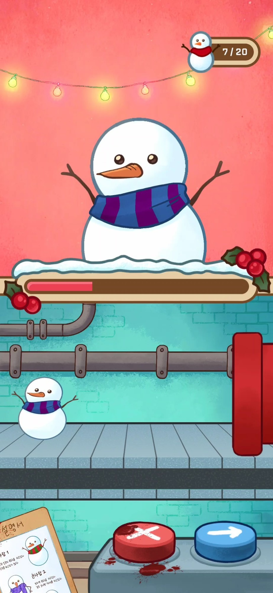
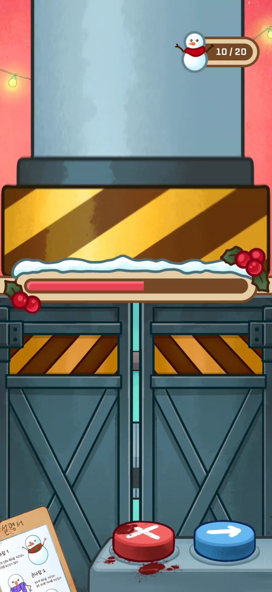
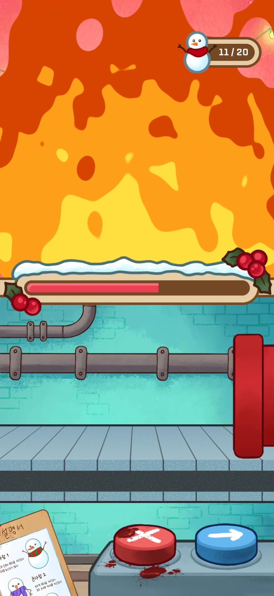
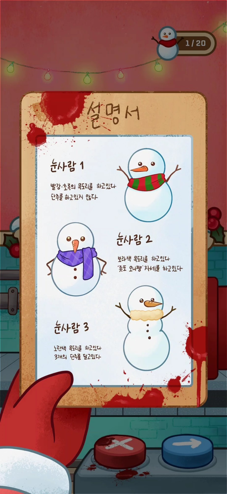

# Snowman Factory

> 제1회 크래프톤 JDC톤 게임잼/해커톤 (2025.12.19 ~ 2025.12.21)

  
  
  

  

## 소개

산타의 눈사람 공장에서 컨베이어 벨트로 올라오는 눈사람을 검수하는 게임입니다.

설명서에 적힌 정상 눈사람의 조건과 비교해 불량품을 골라내고, 제한 시간 안에 목표한 수만큼 정상 눈사람을 출고하면 성공입니다.

## 플레이 방법

| 버튼 | 동작 |
|---|---|
| 📋 설명서 (왼쪽 아래) | 정상 눈사람의 조건 확인 |
| ➡️ | 정상 눈사람 출고 |
| ❌ | 불량 눈사람 폐기 (프레스 또는 화염 연출) |

  

## 플랫폼

| 플랫폼 | 배포 형태 |
|---|---|
| 웹 | 데스크톱 · 모바일 브라우저 (세로 화면) |
| 안드로이드 | APK |

## 개발

- Unity 2022.3
- GitHub Actions 자동 빌드 (WebGL / Android)
